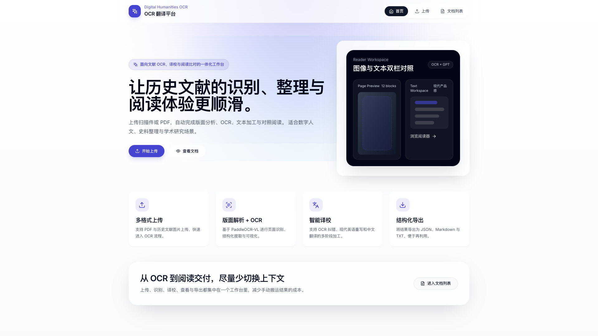

# East India Company Canton Factory Archives Platform (1792–1793)

**东印度公司广州商馆（1792–1793）档案数字文本与全文检索平台**

<div align="center">
  
</div>

---

## 📖 Project Overview

A digital humanities platform for digitizing, OCR processing, and full-text search of historical archives from the East India Company's Canton Factory (1792–1793). This platform combines modern OCR technology with LLM-assisted text correction to preserve and make accessible rare historical documents.

**本平台致力于东印度公司广州商馆历史档案的数字化、OCR识别与全文检索，结合现代 OCR 技术与大语言模型辅助纠错，保存并开放珍稀历史文献。**

---

## ✨ Key Features

- **🔍 High-Accuracy OCR**: Powered by PaddleOCR-VL for layout-aware document parsing
- **🤖 LLM-Assisted Correction**: DeepSeek-V3 intelligent text correction with historical context awareness
- **📄 Multi-Format Support**: PDF, images (PNG, JPG) with automatic page splitting
- **🎯 Precise Bbox Rendering**: Accurate text region highlighting with fixed coordinate alignment
- **🌐 Modern Web Interface**: Next.js + React responsive viewer with real-time preview
- **📦 Batch Processing**: Celery-based async task queue for document-level processing
- **💾 Structured Export**: JSON, Markdown, TXT export with customizable formats

---

## 🏗️ Architecture

<div align="center">
  
</div>

### Tech Stack

**Frontend**

- Next.js 14 (App Router)
- TypeScript
- Tailwind CSS
- Lucide Icons

**Backend**

- FastAPI (Python 3.12+)
- SQLAlchemy + PostgreSQL
- Celery + Redis
- httpx (async HTTP client)

**AI Services**

- PaddleOCR-VL 1.6 (Layout parsing + OCR)
- DeepSeek-V4-Pro (Text correction)

---

## 🖼️ Effect Rendering

<div align="center">
  
</div>

---

## 📦 Sample Export

This document is a sample case exported by the system.

[Download the sample DOCX](<./assets/sample-export/P1-140-China%20and%20Japan%20Duplicates%2C%2024%20Sep%201792%20-%2010%20Mar%201794.docx>)

---

## 🚀 Quick Start

### Prerequisites

- Docker & Docker Compose
- Node.js 18+
- Python 3.12+
- PostgreSQL 14+
- Redis 7+

### 1. Clone Repository

```bash
git clone https://github.com/yumingjie0405/EIC-Canton-Factory-Archives-1792-1793.git
cd EIC-Canton-Factory-Archives-1792-1793
```

### 2. Configure Environment

**Backend** (`backend/.env`):

```bash
cp backend/.env.example backend/.env
# Edit backend/.env and set:
# - DATABASE_URL
# - PADDLE_OCR_URL (your PaddleOCR service endpoint)
# - GPT_API_KEY (API key)
```

**Frontend** (`frontend/.env.local`):

```bash
cp frontend/.env.example frontend/.env.local
# Edit frontend/.env.local if needed
```

### 3. Deploy PaddleOCR Service (Optional)

See [deploy/paddleocr_vl/README.md](deploy/paddleocr_vl/README.md) for deployment instructions.

Or use the public endpoint (if available).

### 4. Start Services

**Option A: Docker Compose (Recommended)**

```bash
docker-compose up -d
```

**Option B: Manual Start**

```bash
# Start backend
cd backend
pip install -r requirements.txt
uvicorn app.main:app --reload

# Start Celery worker (in another terminal)
celery -A app.tasks.celery_app worker --loglevel=info

# Start frontend (in another terminal)
cd frontend
npm install
npm run dev
```

### 5. Access Platform

- **Frontend**: http://localhost:3000
- **Backend API**: http://localhost:8000
- **API Docs**: http://localhost:8000/docs

---

## 📄 License

[MIT License](LICENSE)
